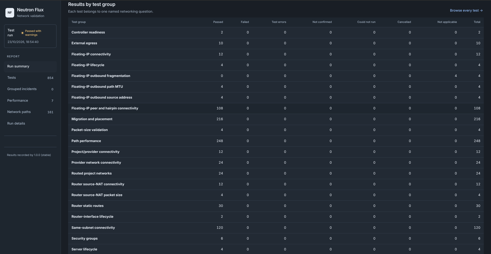
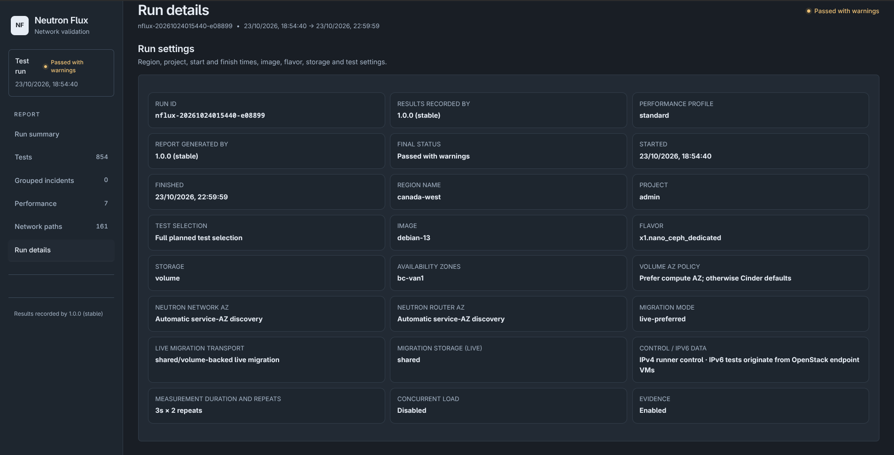

# Neutron Flux

[](https://github.com/webnifico/neutron-flux/actions/workflows/ci.yml)

**v1.0.0**

Neutron Flux is an OpenStack network validation suite with automated infrastructure
discovery, dynamic test topology generation, and functional, performance and
migration testing.

It creates disposable virtual machines and network resources, exercises the
applicable traffic paths, and produces reports containing the results, placement,
commands and diagnostic evidence.

## What problem this solves

Healthy services, ACTIVE instances and configured networks do not establish that
traffic reaches its destination. Connectivity can differ between compute hosts,
IP families, routing arrangements and instance placements, or fail after a
migration even when the cloud operation completes.

Flux turns those checks into a repeatable workflow: discover capabilities, plan
the applicable tests, create resources, verify real instance traffic, exercise
changes, collect evidence and clean up.

## What gaps it fills

| Operational question | Flux coverage |
| --- | --- |
| Does real instance traffic reach its destination? | ICMP, TCP and UDP checks with endpoint evidence. |
| Does connectivity work within and between compute hosts? | Verified same-host and different-host placements for eligible topologies. |
| Are IPv4 and IPv6 both working? | Independent checks for each applicable IP family. |
| Do private and provider networks route correctly? | Applicable fixed-IP paths, subnet/router arrangements and selected provider-network combinations. |
| Do floating IPs and SNAT work? | IPv4 translation checks, including endpoint identity and translated-source evidence where applicable. |
| Do configuration changes take effect? | Security-group, static-route and router lifecycle checks, including expected blocking and restoration. |
| Can larger packets traverse the path? | MTU measurements with advertised and observed values. |
| Does networking survive migration? | Placement, connectivity, established TCP continuity and traffic-recovery checks. |
| Has behavior changed after maintenance? | Saved evidence, offline run comparison and trends. |

Flux complements monitoring and API-level testing with direct evidence from the
instances it creates. Coverage is selected from discovered capabilities and the
requested scope; missing evidence remains visible.

## Administrator access

**Neutron Flux is intended to be run by a cloud administrator with full cloud
access.**

Administrator permissions are required for cloud-wide discovery, compute-host
selection, placement verification, diagnostics and migration operations.

Before running Flux, authenticate OpenStackClient using administrator credentials
scoped to the project where Flux will create its test resources.

## Requirements

Run Flux from a Linux administration node with:

- Python 3.10 or newer.
- OpenStackClient.
- `ssh` and `ssh-keygen`.
- Administrator credentials scoped to the test project.
- Sufficient quota and capacity for the selected suite.
- A supported Linux cloud image with working SSH access and required guest tooling.
- Cinder access when using volume-backed instances.

The guest SSH account is inferred from image metadata or a recognized
distribution name. Custom images should provide `os_admin_user` or
`admin_user` metadata.

Some checks require guest root access or passwordless sudo. Floating-IP ICMP
destination verification requires the permissions needed for a bounded raw-packet
observation.

**Flux creates, migrates and deletes test resources.** The `plan` command
previews coverage and resource requirements without creating resources.

## Installation

From a repository checkout or extracted source release:

```bash
cd neutron-flux

python3 -m venv .venv
source .venv/bin/activate

python -m pip install . python-openstackclient

neutron-flux --version
neutron-flux run --help
```

Authenticate using your normal OpenStack environment or `clouds.yaml`.
Flux itself uses CLI arguments and does not load a Flux configuration file.

Direct source execution is also supported:

```bash
python3 neutron-flux.py run --help
```

## Example commands

Replace image, flavor, network, volume-type, zone and host names with values
from your cloud.

### Preview the suite

```bash
neutron-flux plan \
  --image debian-13 \
  --flavor x1.nano \
  --storage host \
  --external-networks Public1,Public2,Public3 \
  --zones all
```

### Run across all available compute zones

Use volume-backed instances and a specific Cinder volume type:

```bash
neutron-flux run \
  --image debian-13 \
  --flavor x1.nano_ceph_dedicated \
  --storage volume \
  --volume-type ultra \
  --external-networks Public1,Public2,Public3 \
  --zones all
```

### Test one availability zone

```bash
neutron-flux run \
  --image debian-13 \
  --flavor x1.nano \
  --storage host \
  --external-networks Public1,Public2 \
  --zones bc-van1
```

### Test specific compute pairs

```bash
neutron-flux run \
  --image debian-13 \
  --flavor x1.nano \
  --storage host \
  --external-networks Public1,Public2 \
  --target-host-pairs hyper001:hyper002,hyper003:hyper004
```

Host selectors determine compute-zone scope and cannot be combined with
`--zones`. `--target-hosts` and `--target-aggregates` are also available.

### Use cold migration

```bash
neutron-flux run \
  --image debian-13 \
  --flavor x1.nano \
  --storage host \
  --external-networks Public1 \
  --zones bc-van1 \
  --migration-mode cold
```

### Repeat the suite

```bash
neutron-flux run \
  --image debian-13 \
  --flavor x1.nano \
  --storage host \
  --external-networks Public1,Public2 \
  --zones all \
  --repeat 3 \
  --performance-profile exhaustive
```

Each pass has its own reports and cleanup. Performance runs on all eligible
paths; `standard` and `exhaustive` control sampling depth.

### Add simultaneous traffic measurements

```bash
neutron-flux run \
  --image debian-13 \
  --flavor x1.nano \
  --storage host \
  --external-networks Public1 \
  --zones bc-van1 \
  --concurrent-vm-pairs 1,2,4
```

Add `--keep-resources` to retain the test resources remaining at completion,
including after failure.

## Placement and migration

Each eligible topology and host pair runs in its verified initial placement,
then in the opposite placement relation. One endpoint moves: the suite covers
one same-host placement and one different-host placement, with applicable
traffic directions and IP families checked in each.

Live migration is the default, with five live attempts and a cold fallback after
eligible, verified failures. Cold fallback does not establish successful live
migration. Migrations remain within a compute availability zone.

Multiple selected compute zones enable applicable within-zone and between-zone
connectivity tests. Compute, network, router and Cinder AZ capabilities are
discovered separately. Requested hints, fallback reasons and observed placement
are recorded.

## Coverage and result interpretation

- IPv4 and IPv6 are assessed independently. External checks use the families
  supported by the selected external networks; internal fixed-IP routing retains
  its applicable IPv4 and IPv6 coverage independently.
- IPv6 does not enter floating-IP or IPv4 NAT tests.
- Selecting multiple providers declares that their shared IP families should
  route between those networks.
- Security and routing isolation phases explain when blocking traffic is the
  expected passing outcome.
- MTU measurements include applicable private-network paths. Differences are
  reported with advertised and measured values; packet-delivery failures retain
  their own verdicts.
- A completed migration with verified placement, surviving TCP and recovered
  traffic can pass while carrying a separate interruption observation. These
  observations reflect the goal of zero customer downtime.
- Failures, execution errors, blocked checks and observations remain distinct.
  Missing evidence does not become a pass.

## Reports and recovery

Reports are written beneath:

```text
neutron-flux-reports/runs/RUN_ID/
```

Outputs include standalone HTML, JSON, text, JUnit and supporting evidence.
The HTML report provides a run summary, planned versus executed coverage,
traffic paths, endpoints, compute placement, measurements, diagnostics and
manual reproduction procedures where sufficient inputs are available.

### Sample lab report

[Download the v1.0.0 sample lab report (ZIP)](support/examples/neutron-flux-v1.0.0-lab-report.zip).

Extract the ZIP and open `neutron-flux-v1.0.0-lab-report.html` in a browser.
The HTML file contains its report data and scripts; no other run files are needed.
This example was generated by Neutron Flux v1.0.0 in a lab environment.

#### Results by test group



#### Run details



### Run recovery

Inspect the latest checkpoint or resume an interrupted run:

```bash
neutron-flux status
neutron-flux run --resume RUN_ID
```

Preview and perform cleanup:

```bash
neutron-flux cleanup --dry-run
neutron-flux cleanup --yes
```

Explicit cleanup considers all Flux-owned resources in the authenticated project,
including retained resources, active runs and discovered orphans. Ownership and
resource absence are verified; unresolved operations and remaining resources
are reported.

Use `--output-dir PATH` consistently when working with a different report
directory.

## Compare saved runs

These commands work offline:

```bash
neutron-flux report neutron-flux-reports/runs/RUN_ID/results.json
neutron-flux compare baseline/results.json candidate/results.json
neutron-flux trend neutron-flux-reports
```

## Scope and limits

A passing run establishes the recorded behavior for the tested endpoints,
placements and time. An ordinary availability-zone run does not test every
compute host; host and aggregate selectors provide explicit host coverage.

Flux validates OpenStack-visible resource state and guest traffic. It does not
directly inspect OVN databases, Open vSwitch flows, FRR configuration or physical
network devices.

Performance measurements describe the tested workload and path. Offline tests
do not establish live-cloud certification.

## Documentation and development

- [CLI reference](support/docs/CLI-REFERENCE.md)
- [Availability-zone placement](support/docs/AZ-PLACEMENT.md)
- [Routing policy and observation boundaries](support/docs/ROUTING-POLICY.md)
- [Development and release checks](support/docs/TESTING.md)

Automated CI runs the offline release gate on pull requests and pushes to `main`,
including tests, coverage, report interaction checks and package installation.
The CI badge reports the status of these offline checks.

The optional manual live-certification workflow requires a self-hosted OpenStack
runner and the certification environment described in the development docs.
It runs only when manually dispatched.

The source release includes the application, documentation, tests and compressed
sample lab report. Other generated reports, credentials and local environments
remain outside version control.

## License

Copyright 2026 xneelo Cloud Team.

Licensed under the [Apache License, Version 2.0](LICENSE).
See [NOTICE](NOTICE) for attribution information.

